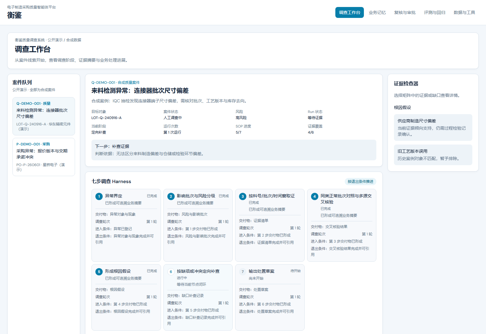
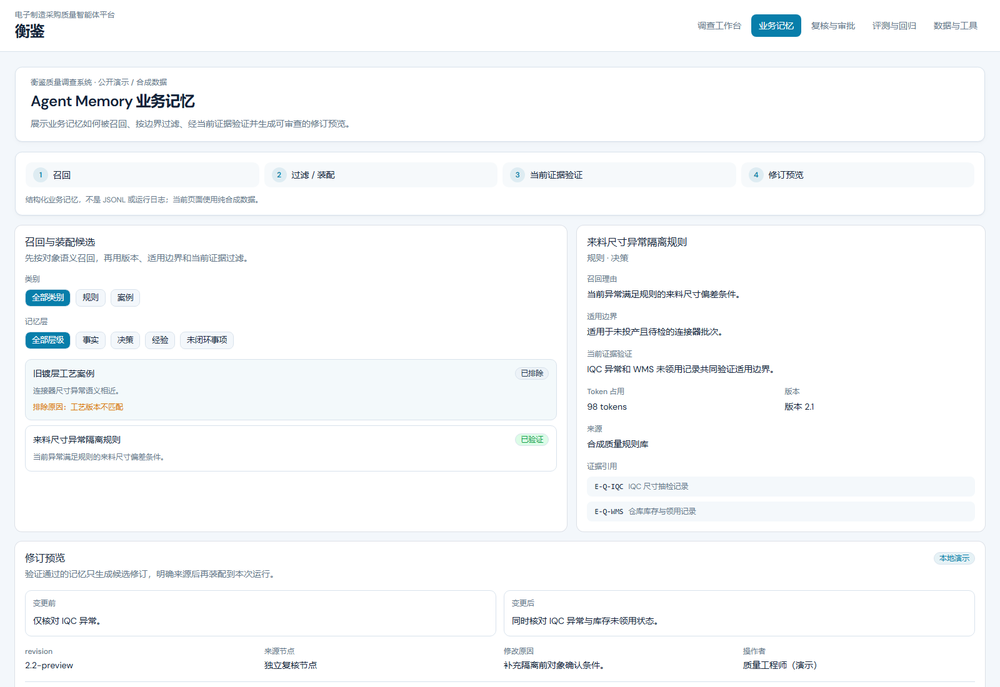
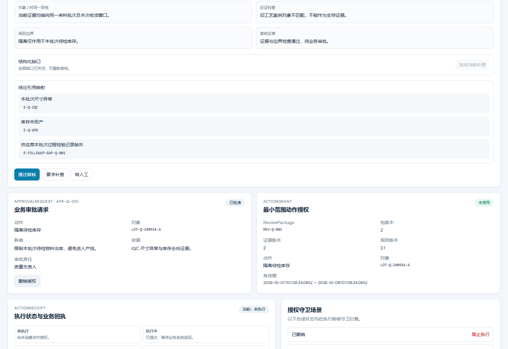
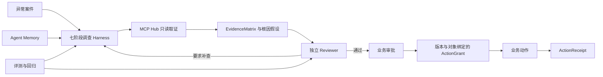
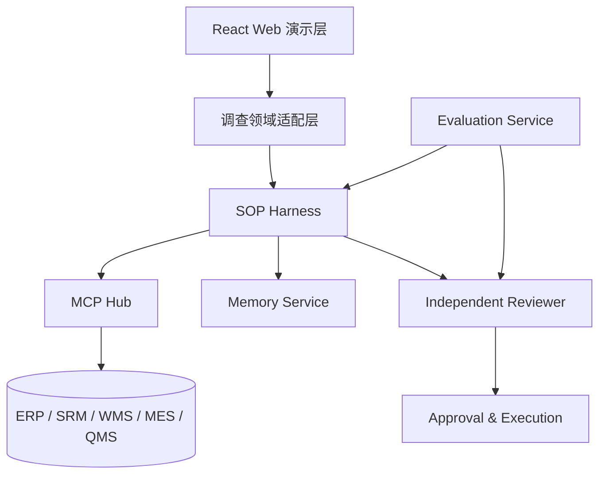

# 衡鉴 · 电子制造采购质量智能体平台

衡鉴是面向电子制造采购异常处置与质量异常调查的 Agent 前端演示。项目把业务数据取证、七阶段调查 Harness、Agent Memory、独立 Reviewer、业务审批、动作授权和评测回归组织为一条可检查、可恢复的工作流。

当前仓库使用合成案件和浏览器本地状态，重点展示前端功能、交互闭环与架构设计。它不连接真实 ERP、SRM、WMS、MES 或 QMS，也不执行真实业务动作。

## 演示路径

启动 Web 后访问：

- `/demo/investigation`：调查工作台
- `/demo/memory`：业务记忆
- `/demo/review`：独立复核、审批与动作回执
- `/demo/evaluation`：评测与回归能力
- `/demo/tools`：数据与只读 MCP 工具

访问 `/demo` 会进入调查工作台。这组路由位于登录守卫之外，便于 GitHub 项目展示和直接分享。

## 页面预览

### 调查工作台



### Agent Memory



### 业务审批与限定授权



## 主流程



调查 SOP 固化为：**异常界定 → 影响批次与风险分级 → 按料号/批次/时间窗取证 → 同类正常批次对照与多源交叉核验 → 形成根因假设 → 按缺项或冲突定向补查 → 输出处置草案**。

## 五项功能

### 1. 调查工作台

- 质量异常与采购异常使用独立合成案件。
- 展示七阶段 SOP 的进入条件、交付物、退出条件和补查轮次。
- EvidenceMatrix 将根因假设与支持、反证、缺失、过期和对象不匹配五类证据状态对应起来。
- 证据检查器把缺口、查询范围、工具调用、返回记录与判断变化串成闭环。
- Run 保存当前阶段、尝试次数与检查点，支持等待证据和转人工状态。

### 2. Agent Memory

- 对规则、案例和经验进行召回、适用边界过滤与当前证据验证。
- 显示召回理由、来源、版本、引用证据和 Token 占用。
- 旧工艺案例因版本不匹配被排除；验证通过的规则只生成可审查修订预览。
- “装配到本次运行”写入当前 Case 的领域状态并更新 ReviewPackage 规则版本，跨页面保持；该状态仍只存在于浏览器演示，不写入外部系统。

### 3. 独立复核与审批

- Reviewer 运行在独立只读 Session，检查候选结论、证据覆盖、对象与时间一致性、反证和规则边界。
- Review pass 只代表复核通过，仍需业务责任人发起并批准动作。
- ActionGrant 绑定对象、动作、ReviewPackage、包版本、证据版本、规则版本与有效期。
- 成功执行、失败和结果未知分别进入不同的回执与恢复路径。

### 4. 评测与回归

- 展示版本实验、数据集、指标口径、故障分类、发布门禁和恢复验证六类能力。
- 公开页只说明评测对象、维度、口径、失败分类、门禁决策与恢复动作。
- 真实评测执行记录、样本和成绩不进入公开演示。

### 5. 数据与工具

- MCP Hub 将 ERP、SRM、WMS、MES、QMS 封装为只读 Tool。
- EvidenceQuery 统一料号、供应商、批次、对象和时间窗。
- EvidenceRecord 统一来源记录引用、业务定义、观测值、单位、业务时间与采集时间。
- PreToolUse 在工具执行前检查业务域、对象、权限和参数边界；越界请求直接阻断。
- `returnedEvidenceIds` 把每次调用与返回证据建立可追踪关系。

## 架构



浏览器演示以 Zustand demo store 充当领域适配层。真实部署时由 API adapter 和 repository 替换该 store，保持页面使用的 Case、Run、ReviewPackage、Approval、ActionGrant 与 ActionReceipt 契约稳定。完整边界见 [docs/architecture.md](docs/architecture.md)。

## Craft / MiniClaw 融合边界

- **MiniClaw Web UI 底座**：复用其 React、TypeScript、Vite、Tailwind、组件与响应式布局基础，并保留 MIT 许可证。
- **Craft 交互参考**：借鉴多面板工作区、活动分组、检查器和审批确认的交互组织方式。
- 本仓库不包含 Craft 源码，也不调用 Craft Electron API。
- 当前业务领域模型、合成数据、调查页面、Memory、复核审批、评测与 MCP 展示均为衡鉴新增内容。

## 技术栈

- React 19、TypeScript、Vite
- Tailwind CSS、Radix UI、Lucide React
- Zustand 领域状态
- Vitest 领域单元测试
- Playwright 端到端测试

## 本地启动

```powershell
cd web
npm ci
npm run dev
```

需要 Node.js 20 或更新版本。

浏览器打开 `http://127.0.0.1:5173/demo`。

## 测试与构建

```powershell
cd web
npm test
npm run test:e2e
npm run build
```

`tests/investigation-demo.spec.ts` 使用同一质量 Case 连续覆盖补查证据生成、Memory 修订装配、更新后 ReviewPackage 复核、业务审批、版本绑定授权、执行回执，以及评测页和数据工具页；流程中不重置案件或重复补查。

## 公开数据边界

- 页面数据均带“公开演示 · 合成数据”标识，不包含真实供应商、料号、批次、采购价格、质量记录或人员信息。
- 公开仓库不放置访问凭据、运行日志、真实工具响应、评测样本、评测成绩或可还原业务关系的数据。
- 内部观测日志、真实运行记录、评测样本和成绩不进入公开演示。
- 演示中的审批、授权和执行均为浏览器本地模拟，刷新或重置后恢复初始状态。

## 许可与来源

本项目的 MiniClaw Web UI 衍生部分遵循仓库内 [LICENSE](LICENSE)。归属和融合说明见 [NOTICE.md](NOTICE.md)。
