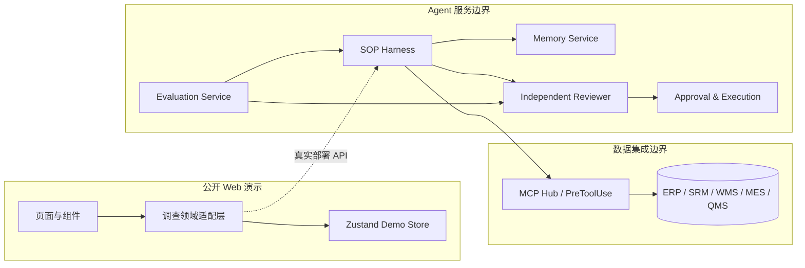
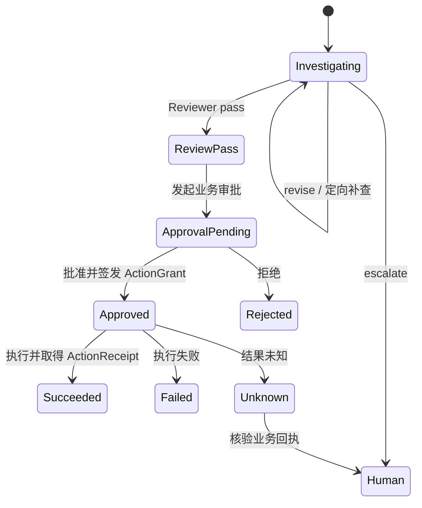

# 衡鉴前端演示架构

## 1. 设计目标

衡鉴将电子制造采购与质量异常处理建模为受约束的 Agent 调查流程。系统的核心约束是：

1. 调查只能在案件授权的业务域、对象和时间窗内读取数据。
2. 证据缺口必须能追溯到补查调用、返回记录和判断变化。
3. 调查、独立复核、业务审批和动作执行分别建模，任何一步都不能隐式代替下一步。
4. 中断、失败与结果未知必须有明确恢复路径，避免盲目重试和重复副作用。

## 2. 服务边界



### Web

负责案件队列、SOP、EvidenceMatrix、证据检查器、Memory、复核审批、评测和工具目录的展示与交互。公开版本只消费合成对象。

### 调查领域适配层

向页面提供稳定的领域命令与查询：选择案件、选择证据、执行补查、提交复核、发起审批、签发授权和执行动作。当前由 Zustand store 同进程实现。

### Harness

固化七阶段 SOP，管理阶段进入条件、交付物、退出条件、轮次、停止条件和人工接管。Harness 生成 EvidenceQuery，并根据证据缺口选择只读工具。

### MCP Hub

对 ERP、SRM、WMS、MES、QMS 的异构接口做统一封装。PreToolUse 在请求离开信任边界前校验业务域、调用主体、对象、时间窗、参数范围和只读策略。调用结果以 EvidenceRecord 返回，并记录 `returnedEvidenceIds`。

### Memory Service

存储规则、案例和经验的版本化条目。召回后还需按对象、工艺版本、时间和适用边界过滤，再用当前证据验证。修订先形成候选版本，经审查后才可持久化。

### Independent Reviewer

在独立只读 Session 中接收 ReviewPackage。Reviewer 检查候选结论、引用映射、证据覆盖、对象与时间一致性、反证和规则边界，输出 pass、revise 或 escalate。

### Approval & Execution

业务审批与 Reviewer 决策分离。批准后签发 ActionGrant，授权绑定动作、对象、包版本、证据版本、规则版本和有效期。执行消费授权并生成 ActionReceipt；失败或结果未知不得自动重放有副作用动作。

### Evaluation Service

管理 Prompt、Harness 与规则组合的版本实验，按数据集和指标口径做回归，将失败归类并给出发布门禁与恢复动作。公开 Web 只展示能力结构。

## 3. Case / Run / Session 分离

| 对象 | 作用 | 生命周期 |
| --- | --- | --- |
| Case | 稳定业务案件，保存对象、风险、证据、缺口与最终处置状态 | 从异常创建到处置完成或人工关闭 |
| Run | 一次 Agent 调查尝试，保存当前阶段、attempt、checkpoint 和运行状态 | 可因等待证据、中断或补查而产生新尝试 |
| Session | Agent 的上下文与权限隔离单元 | 调查 Session 与 Reviewer Session 相互隔离 |

Case 不因单次 Run 失败而丢失。Run 可从检查点恢复，但必须继续绑定同一 Case 对象和证据范围。Reviewer 使用独立 Session，不能继承调查 Agent 的可写权限。

## 4. 复核 / 审批 / 执行状态分离



Reviewer pass 不自动批准动作；Approval approved 不代表已执行；只有成功 ActionReceipt 才能让案件进入处置完成状态。

## 5. 核心对象与事件

### 核心对象

- `InvestigationCase`：案件、风险、业务对象及聚合状态。
- `InvestigationRun`：Session、阶段、尝试次数、检查点与完成摘要。
- `EvidenceQuery`：业务域、料号、供应商、批次、对象与时间窗。
- `EvidenceRecord`：来源记录引用、业务定义、观测值、单位、业务时间、采集时间与领域字段。
- `EvidenceGap`：缺失证据、影响、推荐工具、轮次、停止条件与判断变化。
- `ReviewPackage`：候选结论、引用映射及包、证据、规则三个版本。
- `ApprovalRequest` / `ActionGrant`：审批状态和受限动作授权。
- `ActionReceipt`：执行结果、业务对象和完成时间。

### 关键事件

- `CaseOpened`
- `RunStarted` / `CheckpointSaved` / `RunResumed`
- `EvidenceQueryAllowed` / `EvidenceQueryBlocked`
- `EvidenceCollected` / `EvidenceGapOpened` / `EvidenceGapResolved`
- `MemoryRecalled` / `MemoryExcluded` / `MemoryRevisionProposed`
- `ReviewPassed` / `ReviewRevisionRequested` / `ReviewEscalated`
- `ApprovalRequested` / `ActionGranted` / `ActionRejected` / `GrantRevoked`
- `ActionSucceeded` / `ActionFailed` / `ActionOutcomeUnknown`

真实实现可将这些事件持久化为审计流；公开演示只在浏览器内改变聚合状态。

## 6. 从 demo store 到真实部署

页面不应直接依赖具体后端。建议保留当前领域接口，在构建时或运行时注入实现：

```text
页面组件
  └─ InvestigationGateway
       ├─ DemoInvestigationGateway -> Zustand demo store
       └─ ApiInvestigationGateway  -> HTTP / SSE API
                                      └─ Application Service
                                           ├─ CaseRepository
                                           ├─ RunRepository
                                           ├─ ReviewRepository
                                           ├─ ApprovalRepository
                                           └─ EventRepository
```

真实 repository 应提供乐观锁或事件版本校验。ActionGrant 执行前必须重新核对包版本、证据版本、规则版本、对象、动作、有效期和未使用状态。

## 7. 信任边界与权限

| 边界 | 允许 | 禁止 |
| --- | --- | --- |
| 公开浏览器 | 读取和变更合成演示状态 | 携带真实凭据、访问生产系统 |
| 调查 Agent | 在 Case 的 EvidenceQuery 范围内调用只读 Tool | 跨案件、跨业务域、扩大时间窗、写业务系统 |
| Reviewer | 只读 ReviewPackage 与引用证据 | 调用写工具、替代业务审批 |
| 审批者 | 对明确对象与动作签发有时限授权 | 批准未通过复核或版本不一致的动作 |
| 执行器 | 消费有效 ActionGrant 并写入绑定对象 | 复用授权、盲目重试未知结果 |
| 评测服务 | 读取脱敏数据集和版本化配置 | 在公开页面暴露运行明细或受控数据 |

MCP Hub 是数据系统前的策略执行点，至少执行主体权限、工具 ACL、业务域、对象、参数、时间窗和只读约束检查。审批执行器是写操作前的第二个策略执行点。

## 8. 公开与真实数据边界

公开仓库只包含：

- 合成案件、合成证据、合成供应商与合成工具响应。
- 页面功能、交互状态、领域类型、架构和测试。
- 评测能力结构及抽象口径。

真实部署环境保存：

- 业务系统访问凭据与 Tool 配置。
- 真实订单、批次、供应商、检验记录和处置回执。
- 运行事件、内部审计记录、评测数据集、样本与成绩。
- Memory 持久化版本及审批记录。

两侧通过 adapter/repository 契约衔接。公开 Web 构建产物中不得打包真实环境变量、真实数据快照或内部运行产物。
